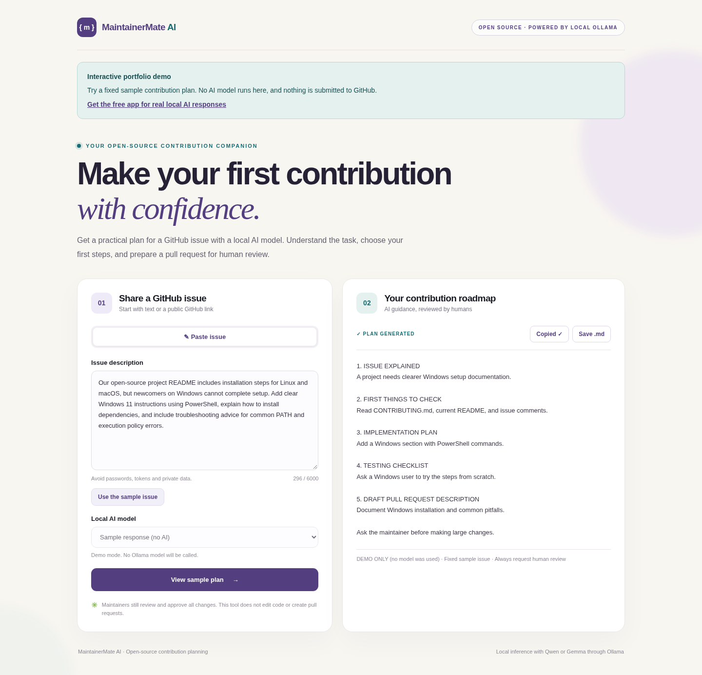

# MaintainerMate AI

[](https://github.com/graceomolola001-cmyk/maintainermate/actions/workflows/tests.yml)
[](LICENSE)

Turn a GitHub issue into a contribution plan using a local AI model. Built with **Python, FastAPI, JavaScript, and Ollama**, MaintainerMate helps open-source contributors understand an issue and decide what to do next.

**Free to run locally. No paid AI API, API key, or hosted account required.** You supply your computer and an installed Ollama model. GitHub hosts the source. A free GitHub Pages demo can show sample responses; real AI runs locally through Ollama.

## What it does

- Accepts pasted issue text or a public GitHub issue URL.
- Generates an issue explanation, first checks, implementation plan, testing checklist, and draft pull request description.
- Lists your installed Ollama models; defaults to `qwen3:1.7b`.
- Copies or downloads the result as Markdown.
- Provides a clearly labelled demo mode that runs without a model.

It does not inspect repository code, modify files, execute tests for you, or submit contributions. Plans can be inaccurate and need human review. Creating a plan does not automatically make an open-source contribution.



The screenshot shows demo mode with a fixed example response, not live AI output.

## In your browser

The portfolio demo lets visitors try the interface without installing Python or Ollama. It displays one fixed, clearly labelled sample plan. It does not analyze arbitrary issues or contact your laptop.

Once GitHub Pages has been enabled and the deployment workflow has succeeded, open:
**https://graceomolola001-cmyk.github.io/maintainermate/**

Click **View sample plan**, then try **Copy** or **Save .md**. For real AI responses, follow the local setup instructions below.

### Enable the free portfolio demo (repository owner)

1. Merge the demo changes into `main`.
2. Open the repository's **Settings → Pages** and select **GitHub Actions** as the build and deployment source.
3. Open **Actions → Deploy portfolio demo → Run workflow**, choose `main`, and run it. Subsequent pushes to `main` redeploy automatically.
4. Wait for both build and deployment to succeed, then open the URL shown by the deployment. Before deployment succeeds, the address may return 404.

This uses GitHub Pages for a public repository and needs no paid AI service or secret. It publishes only static demo assets, not FastAPI or Ollama. If GitHub requires approval for the `github-pages` environment, approve that deployment in the repository.

To preview the same static demo locally:

```powershell
python scripts/build_demo.py
python -m http.server 8080 --bind 127.0.0.1 --directory _site
```

Open **http://127.0.0.1:8080**. To run real AI, use the FastAPI instructions below instead.

## Requirements

- Python **3.10+** and pip.
- [Ollama](https://ollama.com/) running locally with a model already installed for real inference. `qwen3:1.7b` is the default; other installed models can be selected.
- A modern browser. Initial inference can take a few minutes on a CPU.

The commands below never download models. If you have none, demo mode still works. No Node.js build is required.

## Windows PowerShell

Clone the repository into a writable directory of your choice, or download and fully extract its ZIP. Open normal PowerShell **in the project folder** containing `requirements.txt` and `app/`. Do not run from inside the ZIP.

```powershell
git clone https://github.com/graceomolola001-cmyk/maintainermate.git
Set-Location maintainermate
python -m venv .venv
.\.venv\Scripts\python.exe -m pip install -r requirements.txt
```

If `python` is unavailable but the Python launcher is installed, use `py -3 -m venv .venv`. Run commands one at a time and stop if one fails. Virtual environment activation and administrator privileges are unnecessary.

Check your existing Ollama installation:

```powershell
ollama list
Invoke-RestMethod http://127.0.0.1:11434/api/tags
```

If Ollama is offline, open the Ollama application or run `ollama serve` in another terminal. Start MaintainerMate:

```powershell
$env:OLLAMA_MODEL = 'qwen3:1.7b'
$env:MOCK_AI = 'false'
.\.venv\Scripts\python.exe -m uvicorn app.main:app --host 127.0.0.1 --port 8000
```

Open **http://127.0.0.1:8000**, click **Use a sample issue**, then **Generate contribution plan**. Keep the terminal open; press Ctrl+C to stop.

Optional helpers: `./setup.ps1` installs runtime dependencies, `./setup.ps1 -Dev` also installs test dependencies, and `./start.ps1` checks Ollama and the selected model before starting. If PowerShell blocks scripts, use the direct commands above; no execution-policy change is needed.

## Linux and macOS

From the cloned repository:

```bash
python3 -m venv .venv
.venv/bin/python -m pip install -r requirements.txt
ollama list
MOCK_AI=false OLLAMA_MODEL=qwen3:1.7b .venv/bin/python -m uvicorn app.main:app --host 127.0.0.1 --port 8000
```

Open **http://127.0.0.1:8000**. Ollama must be running on this same machine for real inference.

## Demo without Ollama

Demo mode returns the same fixed Windows-documentation example for every valid input. It is intended for trying the UI, not analyzing real issues.

PowerShell:

```powershell
$env:MOCK_AI = 'true'
.\.venv\Scripts\python.exe -m uvicorn app.main:app --host 127.0.0.1 --port 8000
```

Or use `./start.ps1 -Demo`. On Linux/macOS:

```bash
MOCK_AI=true .venv/bin/python -m uvicorn app.main:app --host 127.0.0.1 --port 8000
```

Stop the server and set `MOCK_AI=false` before restarting for real inference.

## API and tests

- `GET /health`: Ollama availability and installed models; inspect `status`, not just the HTTP status code. Demo mode reports `mock`.
- `POST /api/analyze`: supply **either** `issue_text` (20–6000 characters) **or** `github_url`; `model` is optional.
- Interactive API documentation: **http://127.0.0.1:8000/api/docs**.

With the server running, check it from another PowerShell window:

```powershell
Invoke-RestMethod http://127.0.0.1:8000/health
$body = @{ issue_text = 'The README needs Windows PowerShell installation instructions for new contributors.'; model = 'qwen3:1.7b' } | ConvertTo-Json
Invoke-RestMethod http://127.0.0.1:8000/api/analyze -Method Post -ContentType 'application/json' -Body $body -TimeoutSec 240
```

Run automated tests from the project folder:

```powershell
.\.venv\Scripts\python.exe -m pip install -r requirements-dev.txt
.\.venv\Scripts\python.exe -m pytest -q
```

Linux/macOS equivalents use `.venv/bin/python`. Tests mock external model and GitHub requests; no model, account, or internet connection is needed after dependencies are installed. CI is configured for Windows and Linux; a passing badge depends on GitHub actually running the workflow.

## Troubleshooting

| Problem | What to check |
|---|---|
| Access is denied creating `.venv` | Read the exact failing path. Fully extract the ZIP and use a folder writable by your account. An existing environment may be locked by a running process. Close only processes you recognize; do not blindly delete it, disable security controls, or run as administrator. If relocation is needed, copy to a development directory you choose and create a new environment there. |
| Python not found | Try `py -3` on Windows; check `python --version`. |
| Ollama offline | Open Ollama or run `ollama serve`; check `ollama list`. |
| Model missing | Select an installed model in the dropdown, or set `OLLAMA_MODEL` to its exact name. |
| Port 8000 already in use | Stop your earlier app server or start with `--port 8001` and open that port. |
| GitHub URL fails | Only public issue URLs are supported; API access may be blocked or rate-limited. Paste the issue text instead. |
| Generation times out | Check Ollama, close memory-heavy apps, or select a smaller model you already have. |
| `No module named app` | Run from the repository root and check that `app/main.py` exists. |

`.env.example` documents variable names; it is not loaded automatically. Use shell variables as shown above. The Ollama endpoint is fixed to `http://127.0.0.1:11434`.

## Architecture

```text
Browser → FastAPI → Ollama on the same machine
                  → GitHub API (only for public issue URLs)
```

```text
app/
  main.py             API, validation, model prompt, Ollama client
  static/             HTML, CSS, JavaScript; no build step
tests/                Mocked API tests and server smoke test
.github/              Test CI, Pages deployment, contribution templates
scripts/build_demo.py  Builds the sample-only portfolio site in _site/
setup.ps1, start.ps1  Optional Windows helpers
```

Pasted text is sent to your local Ollama service. URL mode additionally sends a request to `api.github.com`; fetching an issue does not inspect its repository code. Model responses are rendered as text rather than HTML.

## Contributing and license

See [CONTRIBUTING.md](CONTRIBUTING.md) for setup and contribution guidelines. Bug reports, accessibility improvements, and documentation contributions are welcome. For sensitive reports, follow [SECURITY.md](SECURITY.md).

Licensed under the [MIT License](LICENSE). Ollama and model weights have their own licenses; they are not bundled with this repository.

This app is designed for localhost. It has no authentication or rate limiting: do not expose the FastAPI or Ollama ports to the internet. The Pages demo serves fixed sample content; GitHub Pages cannot run the Python backend or Ollama. You can showcase this repository and a demo recording in your portfolio without paying for hosting.
